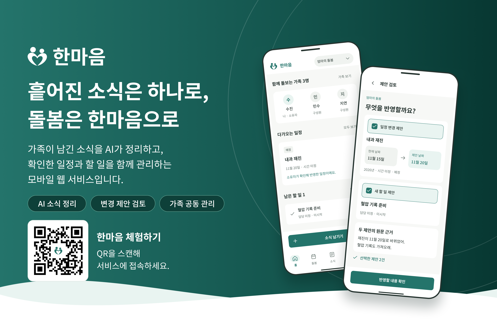

# 한마음 (Hanmaum)

한마음은 가족이 부모님의 돌봄 소식을 함께 기록하고 필요한 일정을 챙기는 웹앱입니다. AI가 소식을 분석해 일정·할 일·확인사항을 제안하면, 가족이 검토하고 공간 소유자가 반영을 확정합니다.

[Team-Hanmaum](https://github.com/Team-Hanmaum)의 팀 프로젝트를 개인 계정에서 확인할 수 있도록 코드와 문서를 모은 저장소입니다. 원본 팀원들의 커밋과 작성자 기록을 보존했습니다.

## 프로젝트 구성

| 폴더 | 내용 | 실행·개발 안내 |
| --- | --- | --- |
| `hanmaum-frontend/` | React·TypeScript·Vite 프론트엔드 | [Frontend README](hanmaum-frontend/README.md) |
| `hanmaum-backend/` | Java 21·Spring Boot·PostgreSQL 백엔드 | [Backend README](hanmaum-backend/README.md) |
| `hanmaum-ai/` | Python·FastAPI AI 분석 서비스 | [AI README](hanmaum-ai/README.md) |
| `hanmaum-docs/` | 기획·기능 명세·제품 정책·아키텍처 문서 | [프로젝트 문서](hanmaum-docs/README.md) |
| `.github/` | 원본 팀 소개와 서비스 이미지 | [팀 소개](.github/profile/README.md) |

각 서비스는 독립 프로젝트입니다. 실행 명령은 해당 폴더로 이동한 뒤 각 README를 따라 진행합니다. 실제 환경설정과 인증키는 별도로 준비하고, 공유 가능한 설정 예시는 각 폴더의 `.env.example`을 참고합니다.

## 주요 문서

- [프로젝트 기획서](hanmaum-docs/product/project-plan.md)
- [기능 명세서](hanmaum-docs/product/feature-spec.md)
- [시스템 아키텍처](hanmaum-docs/development/architecture.md)
- [API 안내](hanmaum-docs/development/api.md)
- [백엔드 구현 계획](HANMAUM_BACKEND_IMPLEMENTATION_PLAN.md)

## 원본 저장소와 가져온 버전

2026년 11월 19일 로컬 작업 폴더의 아래 커밋을 폴더별로 통합했습니다. 각 커밋의 이전 기록은 이 저장소의 Git 기록에서도 확인할 수 있습니다.

| 원본 저장소 | 브랜치 | 커밋 |
| --- | --- | --- |
| [.github](https://github.com/Team-Hanmaum/.github) | `main` | [`5174c2b`](https://github.com/Team-Hanmaum/.github/commit/5174c2b5a1655f469be183471a7c0b962aa813c8) |
| [hanmaum-ai](https://github.com/Team-Hanmaum/hanmaum-ai) | `dev` | [`8bfcc95`](https://github.com/Team-Hanmaum/hanmaum-ai/commit/8bfcc9570553bbfcbee6468a3b1c0781276de21a) |
| [hanmaum-backend](https://github.com/Team-Hanmaum/hanmaum-backend) | `dev` | [`71ec766`](https://github.com/Team-Hanmaum/hanmaum-backend/commit/71ec766d703ec331ad8b80647db833f76b539083) |
| [hanmaum-docs](https://github.com/Team-Hanmaum/hanmaum-docs) | `main` | [`8afe53a`](https://github.com/Team-Hanmaum/hanmaum-docs/commit/8afe53a42073e7502871592a6ba73cd3cb58291f) |
| [hanmaum-frontend](https://github.com/Team-Hanmaum/hanmaum-frontend) | `dev` | [`c54146b`](https://github.com/Team-Hanmaum/hanmaum-frontend/commit/c54146bcdd271af5a8a7ff715b70161c4dd08932) |

이 통합 저장소는 가져온 시점의 복사본이며, 팀 저장소의 이후 변경사항이 자동으로 동기화되지는 않습니다. 원본 프로젝트의 배포 설정과 워크플로 파일은 각 서비스 폴더에 보존되어 있습니다.
